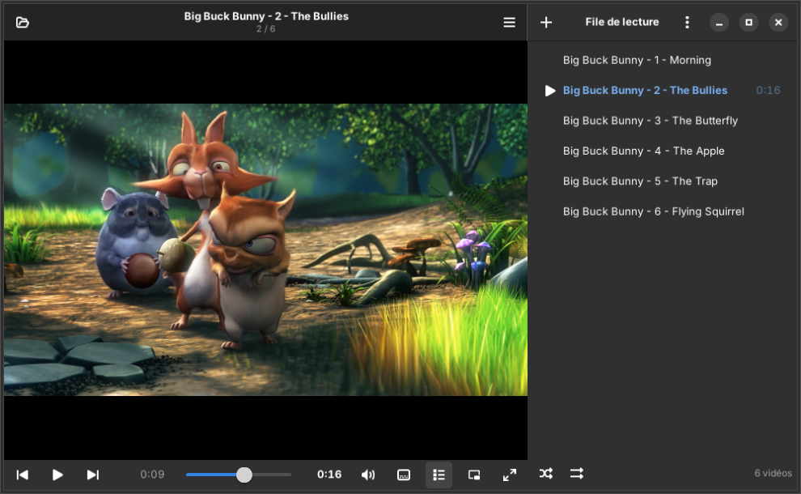
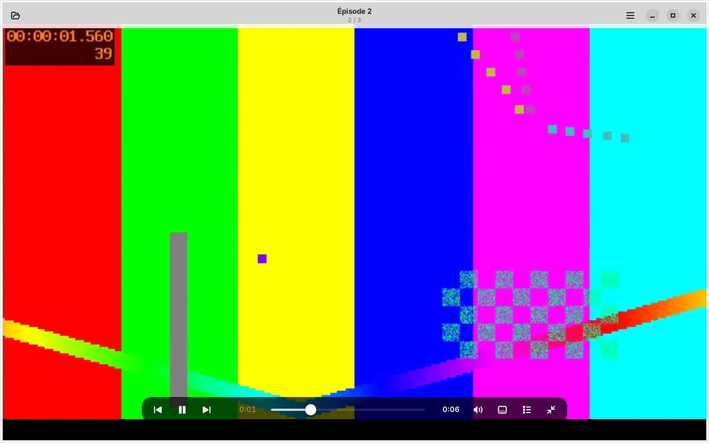
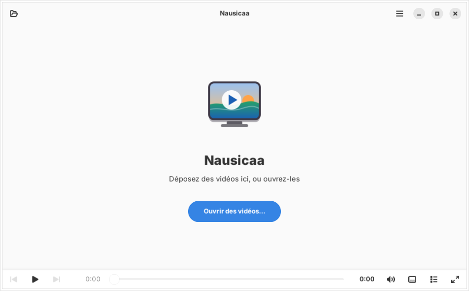

# Nausicaa

**A small GTK4 / libadwaita video player for GNOME that plays your videos, and nothing else. Built on mpv, without Flatpak.**
**Un petit lecteur vidéo GTK4 / libadwaita pour GNOME, qui lit vos vidéos et rien d'autre. Sur mpv, sans Flatpak.**

[English](#english) · [Français](#français) · [Website / Site](https://tofmicro.pages-perso.free.fr/Nausicaa/)



| Full screen / Plein écran | Welcome / Accueil |
|---|---|
|  |  |

---

## English

Nausicaa is a simple window around the [mpv](https://mpv.io) engine, in the spirit of Celluloid, with the mouse
habits of VLC. It is written in Python for Ubuntu 24.04 / Zorin OS 18 (GTK 4.14, libadwaita 1.5) and uses the
distribution's libmpv: no Flatpak. It follows your desktop's GTK theme (Adwaita, light/dark, accent color).

### Features

- **Mouse like VLC, but better**: a click on the picture pauses at once; a **double-click goes full screen
  without pausing**; the **mouse wheel sets the volume**, shown over the picture (up to 150 % if you allow it).
- **Pause when minimised**, resume when the window comes back (only if it was playing).
- **Resume where you left off**: each video remembers its position ("From the start" if you prefer).
- **Following episodes**: open one episode and the other videos of its folder join the queue, in natural order
  ("Episode 2" before "Episode 10"), starting with the one you opened.
- **Play queue** at the side (F9): shuffle, repeat, drag to reorder, Delete to remove, drop files to add; save
  it as a playlist (relative paths). `.m3u`, `.m3u8`, `.xspf`, `.pls` and addresses (streams) open too. The last
  queue is offered again on the welcome page.
- Full screen with bars that fade away, **audio tracks**, **subtitles** (files next to the video are found;
  preferred languages in Preferences), **speed**, frame by frame (`.` / `,`), **picture capture** (S).
- No screen saver while a video plays.

Every feature can be turned off in **Preferences → Features**, without restarting.

### Install

```sh
sudo apt install python3-gi gir1.2-gtk-4.0 gir1.2-adw-1 python3-mpv libmpv2
./install.sh               # in ~/.local, no root
./install.sh --uninstall
```

Or build the package: `dpkg-buildpackage -us -uc -b`.

---

## Français

Nausicaa est une fenêtre simple autour du moteur [mpv](https://mpv.io), dans l'esprit de Celluloid, avec les
gestes de souris de VLC. Écrit en Python pour Ubuntu 24.04 / Zorin OS 18 (GTK 4.14, libadwaita 1.5), il utilise
la libmpv de la distribution : pas de Flatpak. Il suit le thème GTK du bureau (Adwaita, clair / sombre, couleur
d'accent).

### Fonctionnalités

- **La souris comme VLC, en mieux** : un clic sur l'image met en pause tout de suite ; un **double-clic passe en
  plein écran sans mettre en pause** ; la **molette règle le volume**, affiché sur l'image (jusqu'à 150 % si on
  l'autorise).
- **Pause quand la fenêtre est réduite**, reprise quand elle revient (seulement si la vidéo jouait).
- **Reprendre où on s'était arrêté** : chaque vidéo retient sa position (« Depuis le début » si on préfère).
- **Épisodes suivants** : un épisode ouvert amène les autres vidéos de son dossier dans la file, dans l'ordre des
  noms (« Épisode 2 » avant « Épisode 10 »), en commençant par celui qu'on a ouvert.
- **File de lecture** sur le côté (F9) : aléatoire, répétition, glisser pour réordonner, Suppr pour retirer,
  déposer des fichiers pour ajouter ; enregistrement en liste de lecture (chemins relatifs). Les `.m3u`,
  `.m3u8`, `.xspf`, `.pls` et les adresses (flux) s'ouvrent aussi. La dernière file est proposée sur l'accueil.
- Plein écran aux barres qui s'effacent, **pistes audio**, **sous-titres** (ceux posés à côté de la vidéo sont
  trouvés ; langues préférées dans les Préférences), **vitesse**, image par image (`.` / `,`), **capture de
  l'image** (S).
- Pas d'économiseur d'écran pendant la lecture.

Chaque fonctionnalité se coupe dans **Préférences → Fonctionnalités**, sans redémarrer.

### Installation

```sh
sudo apt install python3-gi gir1.2-gtk-4.0 gir1.2-adw-1 python3-mpv libmpv2
./install.sh               # dans ~/.local, sans root
./install.sh --uninstall
```

Ou construire le paquet : `dpkg-buildpackage -us -uc -b`.

## Licence

GPL-3.0-or-later.
