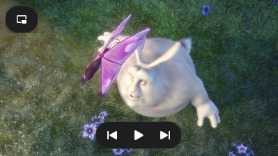
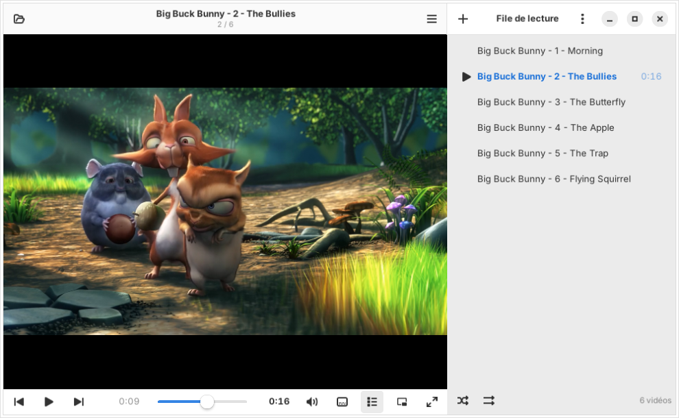
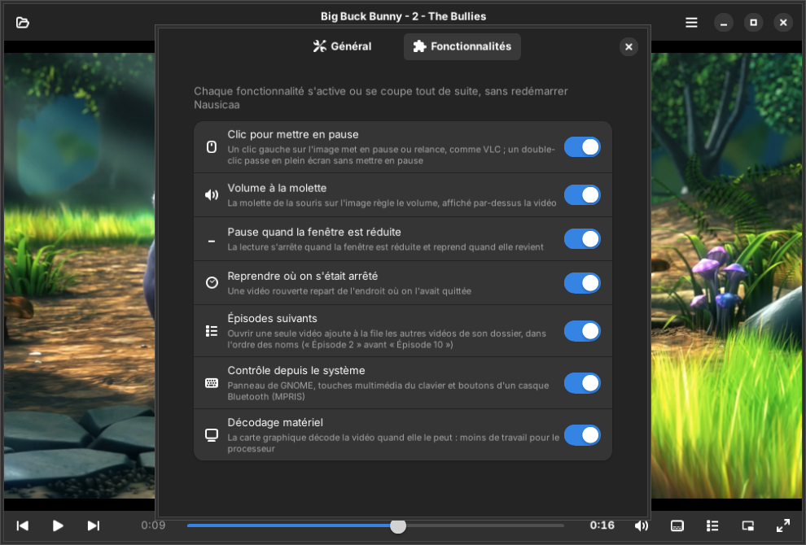

# Nausicaa

**A small GTK4 / libadwaita video player for GNOME that plays your videos, and nothing else. Built on mpv, without Flatpak.**
**Un petit lecteur vidéo GTK4 / libadwaita pour GNOME, qui lit vos vidéos et rien d'autre. Sur mpv, sans Flatpak.**

[English](#english) · [Français](#français) · [Website / Site](https://tofmicro.pages-perso.free.fr/Nausicaa/)


| Full screen / Plein écran | Picture in picture / Image dans l'image |
|---|---|
|  |  |

| Light theme / Thème clair | Features / Fonctionnalités | Welcome / Accueil |
|---|---|---|
|  |  |  |

---

## English

Nausicaa is a simple window around the [mpv](https://mpv.io) engine, in the spirit of Celluloid, with the mouse
habits of VLC — done right. It is written in Python for Ubuntu 24.04 / Zorin OS 18 (GTK 4.14, libadwaita 1.5) and
uses the distribution's libmpv: no Flatpak. It follows your desktop's GTK theme (Adwaita, light/dark, accent
colour, translucent themes included).

### Install

Ubuntu 24.04 "Noble", 26.04 "Resolute" and their derivatives (Zorin OS 18, Linux Mint 22), from the PPA —
updates then arrive with the rest of your system:

```sh
sudo add-apt-repository ppa:nourpon/nausicaa
sudo apt update && sudo apt install nausicaa
```

Other Debian-based distributions (Debian 13…): download `nausicaa_*_all.deb` from the
[Releases](https://github.com/ToFpon/Nausicaa/releases) and open it, or `sudo apt install ./nausicaa_*_all.deb`.

From the source code:

```sh
sudo apt install python3-gi gir1.2-gtk-4.0 gir1.2-adw-1 python3-mpv libmpv2
git clone https://github.com/ToFpon/Nausicaa.git && cd Nausicaa
bin/nausicaa                # try it without installing
./install.sh                # or install it in ~/.local, no root (./install.sh --uninstall to remove)
```

### Features

**The mouse, like VLC — but better**
- A click on the picture **pauses at once**; a **double-click goes full screen without pausing**.
- The **mouse wheel sets the volume**, shown over the picture (up to 150 % if you allow it).
- In full screen, **compact rounded controls** float over the picture and fade away when the mouse rests.

**Picture in picture** (Ctrl+P)
- The film shrinks to a **small borderless 16:9 window, always on top**, in the bottom-right corner of the screen.
- Previous, play / pause, next and a way back **appear when the mouse passes over it**.
- **Drag it** to move it, **pull its edges** to resize it; its **size and place are remembered**.
- Double-click or Escape: the full window comes back, centred.
- Always on top and placement need X11 (GNOME on Wayland doesn't let applications do it).

**Series and films**
- **Following episodes**: open one episode and the other videos of its folder join the queue, in natural order
  ("Episode 2" before "Episode 10"), starting with the one you opened.
- **Resume where you left off**: each video remembers its position ("From the start" if you prefer).
- **Play queue** at the side (F9) — on the right or on the left, as you like (Preferences): shuffle, repeat, drag to reorder, Delete to remove, drop files to add; save it
  as a playlist (relative paths). `.m3u`, `.m3u8`, `.xspf`, `.pls` and addresses (streams) open too. The last
  queue is offered again on the welcome page.
- **Time left or total length**: click it to switch, your choice is kept.

**Sound and picture**
- **Audio tracks**, **subtitles** (files next to the video are found; preferred languages in Preferences),
  **speed**, frame by frame (`.` / `,`), **picture capture** (S) to your Pictures folder.
- **The same volume as VLC**: Nausicaa's slider is the only one that counts (its stream stays at 100 % in the
  system mixer, where it is named "Nausicaa").
- **Hardware decoding** when your graphics card can.

**At home on your desktop**
- **System controls (MPRIS)**: GNOME's media panel, keyboard media keys and the buttons of a **Bluetooth headset**
  (double-tap to pause, earbuds taken off = pause).
- **Pause when minimised**, resume when the window comes back (only if it was playing).
- No screen saver while a video plays.
- English, French and German.

Every feature can be turned off in **Preferences → Features**, without restarting.

### Keyboard

| Keys | Action |
|---|---|
| Space | Play / pause |
| ← / → | Back / forward a few seconds (5, 10 or 30 s, see Preferences) |
| Ctrl+← / Ctrl+→ | Back / forward one minute |
| ↑ / ↓ | Volume |
| M | Mute |
| N / P | Next / previous video |
| . / , | Next / previous frame (paused) |
| F or F11 / Escape | Full screen / leave full screen |
| Ctrl+P | Picture in picture |
| F9 | Play queue |
| V / S | Show / hide subtitles · picture capture |
| Ctrl+O / Ctrl+U | Open videos / open an address |
| F1 | All the shortcuts |

---

## Français

Nausicaa est une fenêtre simple autour du moteur [mpv](https://mpv.io), dans l'esprit de Celluloid, avec les
gestes de souris de VLC, en mieux. Écrit en Python pour Ubuntu 24.04 / Zorin OS 18 (GTK 4.14, libadwaita 1.5), il
utilise la libmpv de la distribution : pas de Flatpak. Il suit le thème GTK du bureau (Adwaita, clair / sombre,
couleur d'accent, thèmes translucides compris).

### Installation

Ubuntu 24.04 « Noble », 26.04 « Resolute » et leurs dérivées (Zorin OS 18, Linux Mint 22), par le PPA — les mises
à jour arrivent ensuite avec le reste du système :

```sh
sudo add-apt-repository ppa:nourpon/nausicaa
sudo apt update && sudo apt install nausicaa
```

Autres distributions à base de Debian (Debian 13…) : télécharger `nausicaa_*_all.deb` dans les
[Releases](https://github.com/ToFpon/Nausicaa/releases) et l'ouvrir, ou `sudo apt install ./nausicaa_*_all.deb`.

Depuis le code source :

```sh
sudo apt install python3-gi gir1.2-gtk-4.0 gir1.2-adw-1 python3-mpv libmpv2
git clone https://github.com/ToFpon/Nausicaa.git && cd Nausicaa
bin/nausicaa                # pour l'essayer sans l'installer
./install.sh                # ou l'installer dans ~/.local, sans root (./install.sh --uninstall pour l'enlever)
```

### Fonctionnalités

**La souris comme VLC, en mieux**
- Un clic sur l'image **met en pause tout de suite** ; un **double-clic passe en plein écran sans mettre en pause**.
- La **molette règle le volume**, affiché sur l'image (jusqu'à 150 % si on l'autorise).
- En plein écran, des **commandes compactes et arrondies** flottent sur l'image et s'effacent quand la souris ne
  bouge plus.

**Image dans l'image** (Ctrl+P)
- Le film devient une **petite fenêtre sans bordure, en 16:9, toujours au-dessus des autres**, en bas à droite de
  l'écran.
- Précédent, lecture / pause, suivant et un bouton de retour **apparaissent au passage de la souris**.
- **On la glisse** pour la déplacer, **on tire ses bords** pour la redimensionner ; **sa taille et sa place sont
  retenues**.
- Double-clic ou Échap : la fenêtre complète revient, au centre de l'écran.
- « Toujours au-dessus » et le placement demandent X11 (GNOME sous Wayland ne le permet pas aux applications).

**Séries et films**
- **Épisodes suivants** : un épisode ouvert amène les autres vidéos de son dossier dans la file, dans l'ordre des
  noms (« Épisode 2 » avant « Épisode 10 »), en commençant par celui qu'on a ouvert.
- **Reprendre où on s'était arrêté** : chaque vidéo retient sa position (« Depuis le début » si on préfère).
- **File de lecture** sur le côté (F9), à droite ou à gauche au choix (Préférences) : aléatoire, répétition, glisser pour réordonner, Suppr pour retirer,
  déposer des fichiers pour ajouter ; enregistrement en liste de lecture (chemins relatifs). Les `.m3u`, `.m3u8`,
  `.xspf`, `.pls` et les adresses (flux) s'ouvrent aussi. La dernière file est proposée sur l'accueil.
- **Temps restant ou durée totale** : un clic pour passer de l'un à l'autre, le choix est retenu.

**Son et image**
- **Pistes audio**, **sous-titres** (ceux posés à côté de la vidéo sont trouvés ; langues préférées dans les
  Préférences), **vitesse**, image par image (`.` / `,`), **capture de l'image** (S) dans le dossier Images.
- **Le même volume que VLC** : seul le curseur de Nausicaa compte (son flux reste à 100 % dans le mélangeur du
  système, où il s'appelle « Nausicaa »).
- **Décodage matériel** quand la carte graphique le peut.

**Chez lui sur le bureau**
- **Contrôle depuis le système (MPRIS)** : panneau multimédia de GNOME, touches multimédia du clavier et boutons
  d'un **casque Bluetooth** (double tape pour la pause, écouteurs retirés = pause).
- **Pause quand la fenêtre est réduite**, reprise quand elle revient (seulement si la vidéo jouait).
- Pas d'économiseur d'écran pendant la lecture.
- Français, anglais et allemand.

Chaque fonctionnalité se coupe dans **Préférences → Fonctionnalités**, sans redémarrer.

### Clavier

| Touches | Action |
|---|---|
| Espace | Lire / mettre en pause |
| ← / → | Reculer / avancer de quelques secondes (5, 10 ou 30 s, voir les Préférences) |
| Ctrl+← / Ctrl+→ | Reculer / avancer d'une minute |
| ↑ / ↓ | Volume |
| M | Couper le son |
| N / P | Vidéo suivante / précédente |
| . / , | Image suivante / précédente (en pause) |
| F ou F11 / Échap | Plein écran / quitter le plein écran |
| Ctrl+P | Image dans l'image |
| F9 | File de lecture |
| V / S | Afficher / masquer les sous-titres · capture de l'image |
| Ctrl+O / Ctrl+U | Ouvrir des vidéos / ouvrir une adresse |
| F1 | Tous les raccourcis |

---

## Licence / License

GPL-3.0-or-later.

Screenshots / captures : [Big Buck Bunny](https://peach.blender.org/), © 2008 Blender Foundation,
[CC BY 3.0](https://creativecommons.org/licenses/by/3.0/), cut into short clips / découpé en courts extraits.
